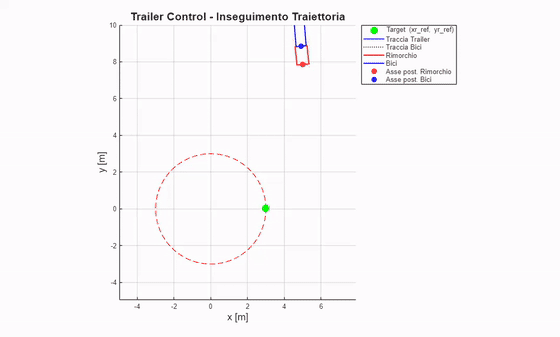
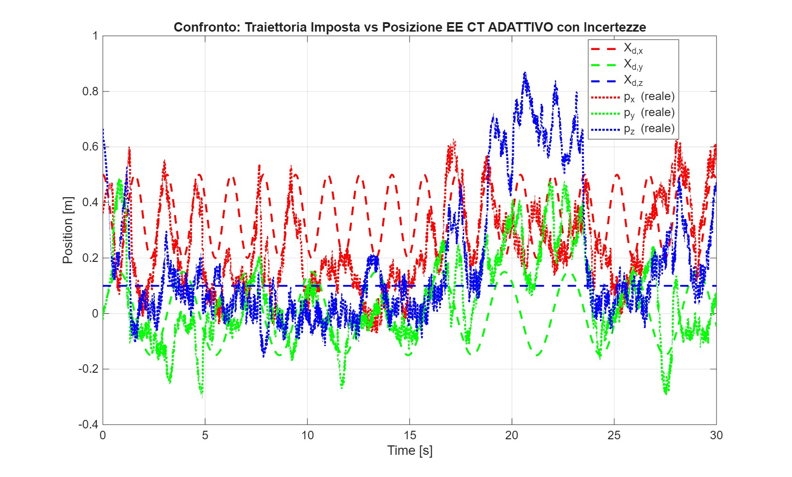
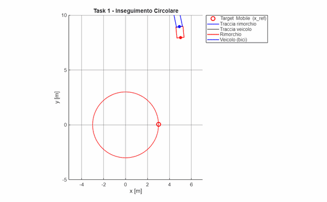

# Robot Control: 6-DoF Manipulator and Bicycle-Trailer Mobile Robot

Course project – *Robotics*, M.Sc. Robotics and Automation Engineering, University of Pisa (2026)
Authors: **Andrea Sodini**, Giulio Sergi

Model-based and adaptive control of an industrial manipulator, nonlinear analysis and control of a bicycle with trailer, and a nonlinear MPC extension. Everything is implemented in MATLAB/Simulink.

## 1. ABB IRB120 manipulator: trajectory tracking under model uncertainty

`01_manipulator_abb_irb120/`

- Robot model from the Robotics System Toolbox (`abbIrb120`). A "real" robot is generated by perturbing link geometry, masses and inertias to emulate model uncertainty.
- **Inverse kinematics** via the Jacobian (q̇ = J⁻¹ẋ, q̈ = J⁻¹(ẍ − J̇q̇)) to track a circular end-effector path.
- Controllers compared on circular, figure-eight and multisine references:
  - **Computed torque**, with critically damped gain tuning;
  - **Backstepping** in task space;
  - **Adaptive computed torque (Li–Slotine)** with online estimation of the dynamic parameters.
- Main finding: on the uncertain model, plain computed torque leaves oscillating, non-zero-mean errors, while the adaptive law drives the tracking error to zero. Regressor conditioning shows why: the figure-eight path violates **persistent excitation**, so the parameter estimates diverge. A multisine reference restores convergence.

| | |
|---|---|
|  |  |
| Task-space tracking, figure-eight path | Regressor conditioning (persistent-excitation analysis) |

## 2. Bicycle with trailer: controllability and observability

`02_trailer_controllability/`

Nonlinear kinematic model analysed with differential-geometric tools: **Lie brackets**, the involutive closure of the accessibility distribution and the observability codistribution. The rank tests (rank = n = 7) confirm small-time local accessibility and controllability, and local observability.

## 3. Bicycle with trailer: feedback linearization + LQR

`03_trailer_feedback_linearization/`

- Choice of a virtual output and relative degree; input–output **feedback linearization**; analysis of the **zero dynamics**.
- Outer **LQR** loop on the linearized double-integrator dynamics (Simulink model).
- A **PID mediator** on the zero dynamics fixes the geometric-constraint problem: the vehicle approaches in forward instead of reverse gear and reaches the ~0.5 cm steady-state error in about 11 s, compared with ~400 s without it (initial error ~8.2 m, circular reference R = 3 m).

## 4. Nonlinear MPC for the bicycle with trailer

`04_trailer_nmpc/`

- Centralized **NMPC**, inspired by Kayacan et al. (2015), with cost J = Σ (eᵀQe + uᵀRu + ΔuᵀR_Δu Δu).
- Explicit constraints: speed −1 ≤ v ≤ 3 m/s, steering |δ| ≤ 35°, **anti-jackknife** |φ| ≤ 60°.
- Circular and figure-eight references; trade-off between prediction horizon (N = 30 vs 45) and computation time; robustness under tightened constraints.

| | |
|---|---|
|  |  |
| NMPC, circular path | Tracking error, figure-eight path |

## How to run

MATLAB R2024a or later with Simulink, Robotics System Toolbox, Control System Toolbox and Optimization Toolbox. Open a folder and run `main.m` (`main_MPC.m` for the NMPC part).

## Tech stack

`MATLAB` · `Simulink` · `Robotics System Toolbox` · `Nonlinear control` · `Adaptive control` · `MPC`
