# Robot Control: ABB IRB120 Manipulator and Bicycle–Trailer Mobile Robot

Course project – *Robotics*, M.Sc. Robotics and Automation Engineering, University of Pisa (2026)
Authors: **Andrea Sodini**, Giulio Sergi · MATLAB / Simulink

| Part | System | Topic | Folder |
|---|---|---|---|
| [1](#1-abb-irb120-model-based-and-adaptive-trajectory-tracking) | 6-DoF ABB IRB120 | Computed torque, backstepping, adaptive control under model uncertainty | `01_manipulator_abb_irb120` |
| [2](#2-bicycletrailer-controllability-and-observability) | Bicycle with trailer | Nonlinear controllability and observability | `02_trailer_controllability` |
| [3](#3-bicycletrailer-feedback-linearization--lqr) | Bicycle with trailer | Feedback linearization + LQR, zero dynamics | `03_trailer_feedback_linearization` |
| [4](#4-bicycletrailer-nonlinear-mpc) | Bicycle with trailer | Nonlinear MPC with constraints | `04_trailer_nmpc` |

---

## 1. ABB IRB120: model-based and adaptive trajectory tracking

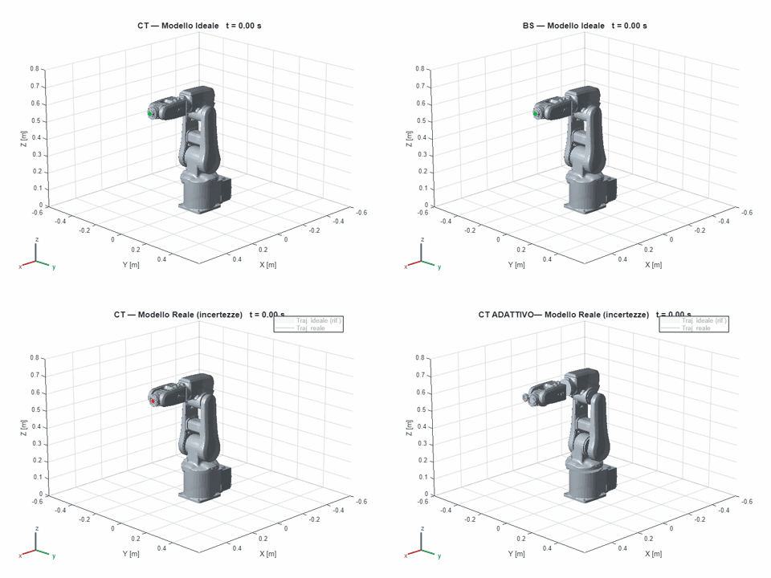

*Circular end-effector trajectory. Top: computed torque and backstepping on the ideal model. Bottom: computed torque and adaptive computed torque on the "real" robot with model uncertainty (ideal path in grey).*

**Setup**
- 6-DoF ABB IRB120 from the Robotics System Toolbox, with Denavit–Hartenberg model.
- A **"real" robot** is created by randomly perturbing link geometry, masses and inertias, so that the controller's model no longer matches the plant.
- Task-space reference: a circle (centre [0.35, 0, 0.10] m, R = 0.15 m, ω = 2 rad/s), plus figure-eight and multisine paths.
- Desired joint trajectories from **differential inverse kinematics**: q̇ = J⁻¹ẋ, q̈ = J⁻¹(ẍ − J̇q̇).

**Controllers**
1. **Computed torque:** τ = M̂(q)[q̈_d + K_d ė + K_p e] + Ĉ(q,q̇)q̇ + ĝ(q), with critically damped gains (K_d = 2ω_n, K_p = ω_n²).
2. **Backstepping** in task space, with a Lyapunov-based design.
3. **Adaptive computed torque (Li–Slotine):** the dynamic parameters are estimated online through the robot's linear-in-parameters regressor Y(q, q̇, q̇_r, q̈_r).

**Results**

| | |
|---|---|
| 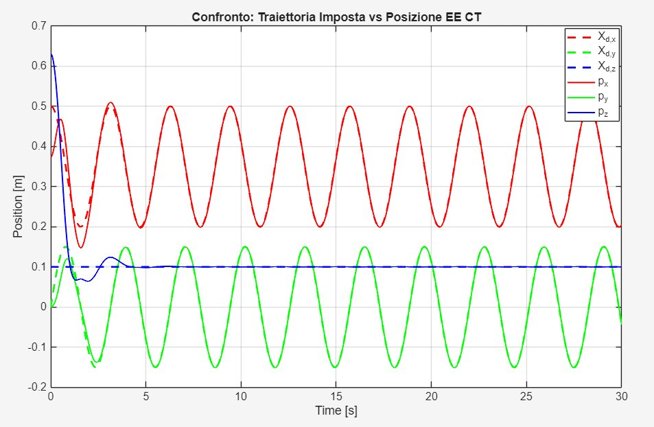 | 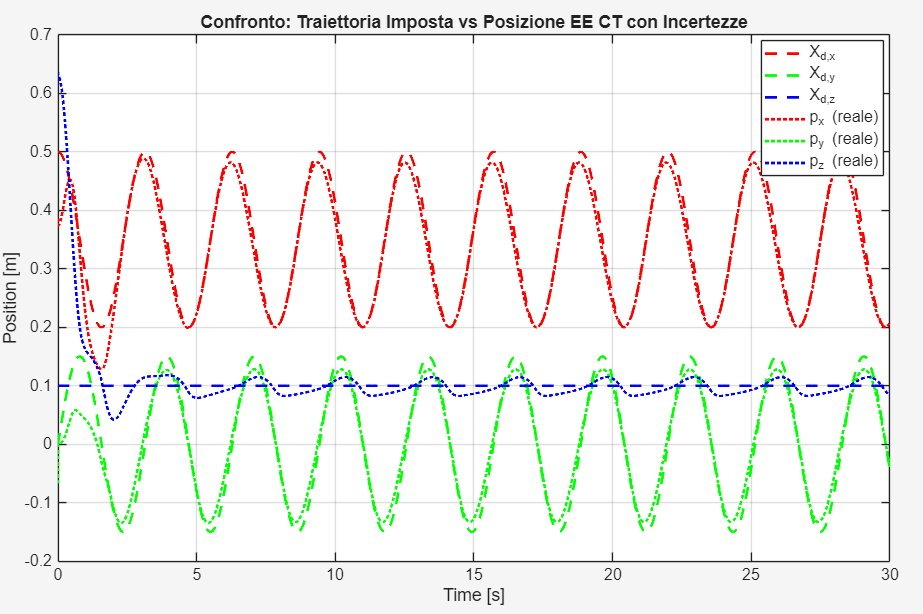 |
| **Computed torque, ideal model:** exact cancellation of the nonlinearities gives near-perfect tracking. | **Computed torque with model uncertainty:** oscillating steady-state errors with non-zero mean. |
| 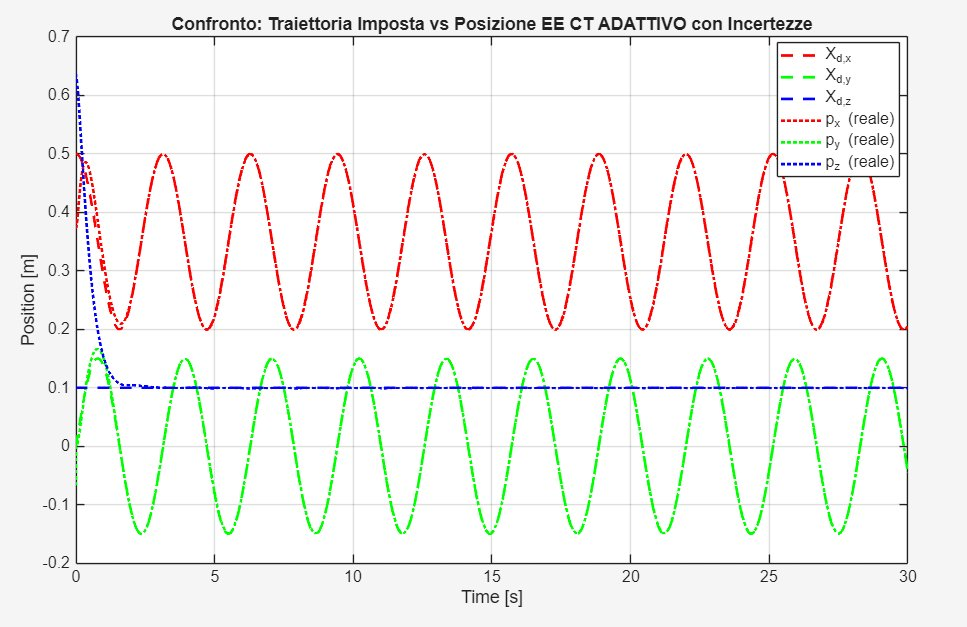 | 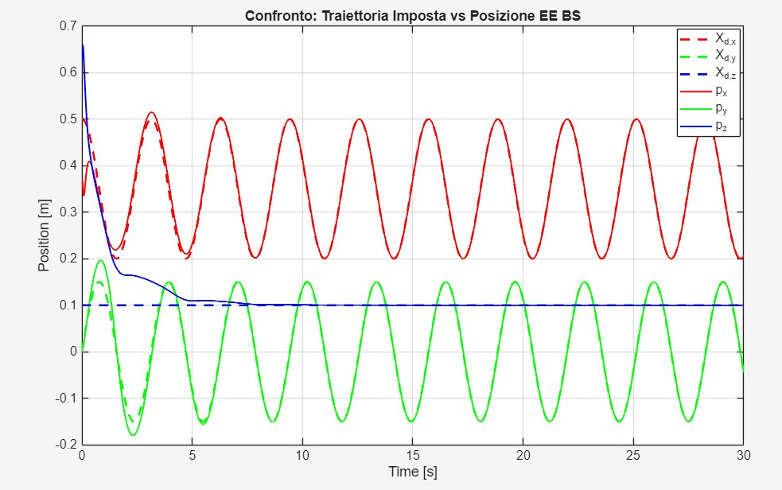 |
| **Adaptive CT with uncertainty, circle:** the errors are compensated and converge to zero. | **Backstepping, ideal model:** good tracking with a small residual error (~0.01 rad). |

**Why the trajectory matters: persistent excitation**

| | |
|---|---|
|  | 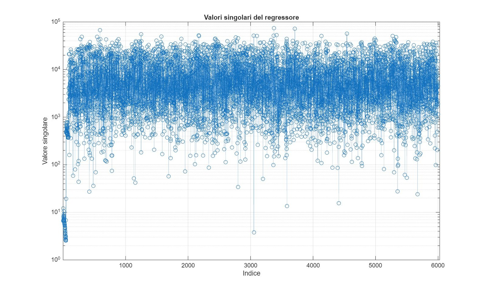 |
| **Figure-eight path:** the adaptive controller loses tracking. | **Regressor singular values:** the path is not persistently exciting, so the Gramian becomes singular and the estimates diverge. |
| 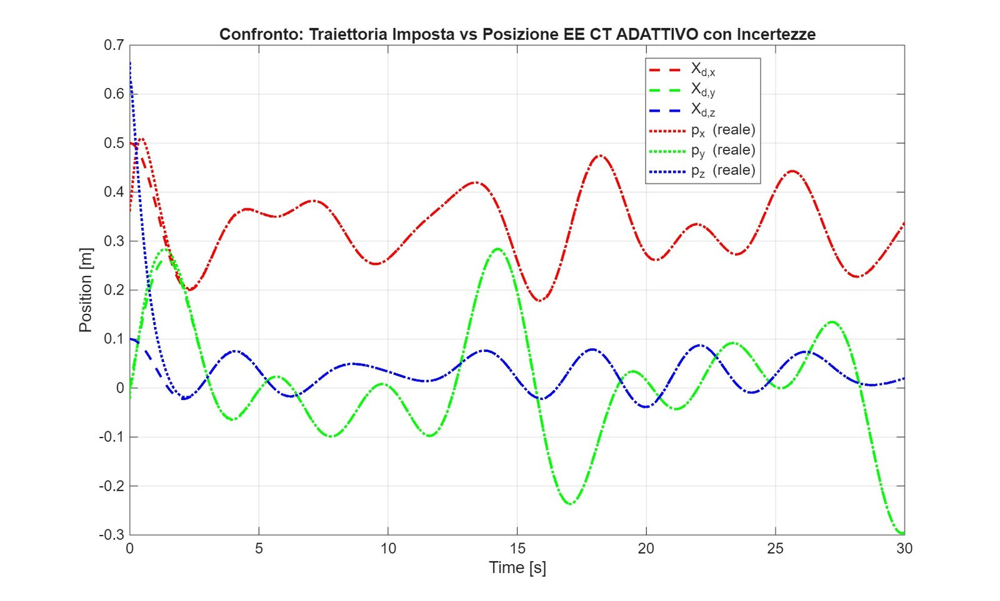 | 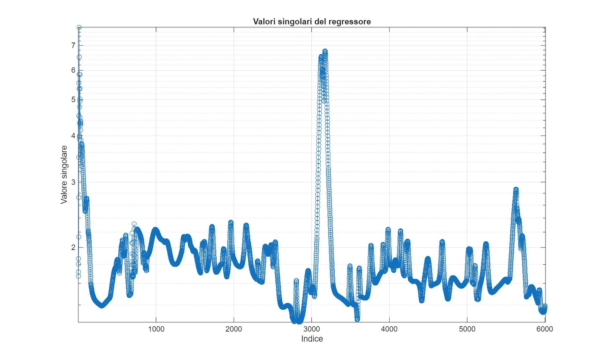 |
| **Multisine path:** stable tracking. | **Regressor singular values:** well conditioned, so the parameter estimates converge again. |

<b>More figures: robot model, inverse kinematics, parameter estimates</b>

| | |
|---|---|
| 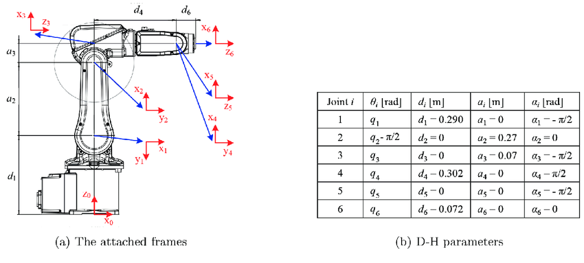 | 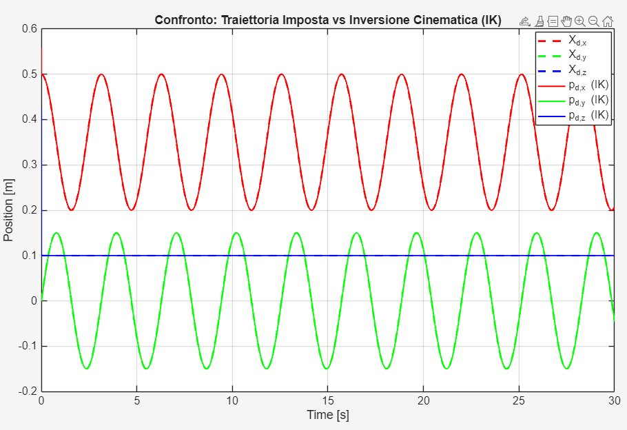 |
| Frames and Denavit–Hartenberg parameters of the IRB120 | Differential inverse kinematics: desired vs obtained end-effector path |
| 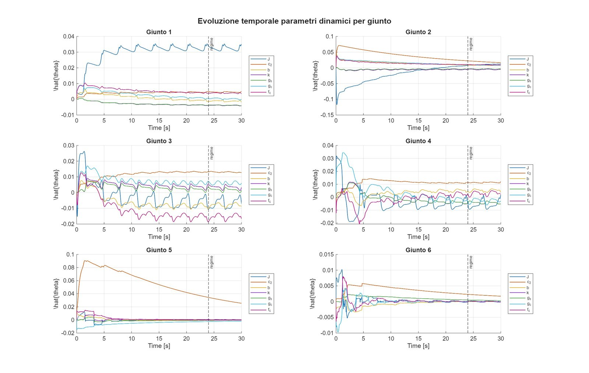 | 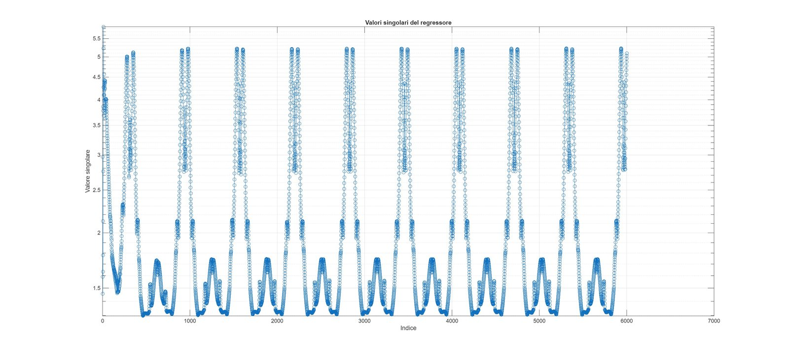 |
| Estimated dynamic parameters per joint (circle) | Regressor singular values, circle path |

---

## 2. Bicycle–trailer: controllability and observability

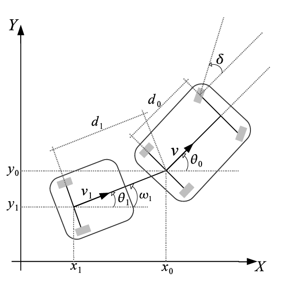

Kinematic model with 7 states; the inputs are the longitudinal jerk and the steering rate, and the output is the trailer position. The analysis uses differential-geometric tools: **Lie brackets**, the involutive closure of the accessibility distribution, and the **observability codistribution**.

- rank Δ* = 7 = n → small-time local accessibility (STLA), hence also weak local accessibility (WLA).
- F(x₀) ≠ 0, F ∉ span{G}, dim Δ_L = 7 → small-time local controllability (STLC).
- rank O* = 7 = n → small-time local observability (STLO).

 

---

## 3. Bicycle–trailer: feedback linearization + LQR

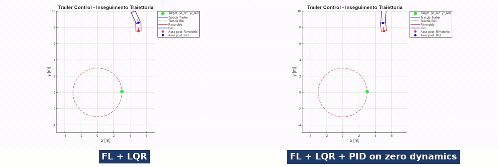

*Tracking a circle (R = 3 m, ω = 0.25 rad/s) from an initial error of about 8.2 m (animation at 2× speed).*

**Method**
- Output on a virtual point ahead of the trailer axle; relative degree 2; input–output **feedback linearization** with the decoupling matrix.
- Outer **LQR** loop on the resulting double integrator, implemented in Simulink.
- **Zero-dynamics analysis:** with the original law the internal dynamics are only weakly stable, and the vehicle approaches in **reverse gear**. A **PID mediator** on the hitch angle fixes this geometric-constraint problem.

**Results**

| | |
|---|---|
| 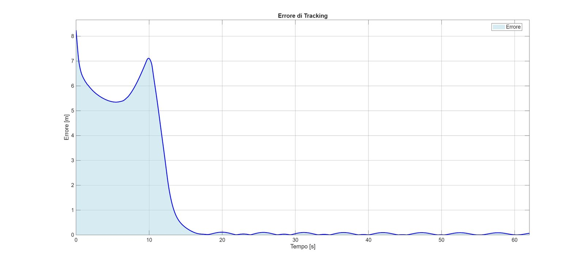 | 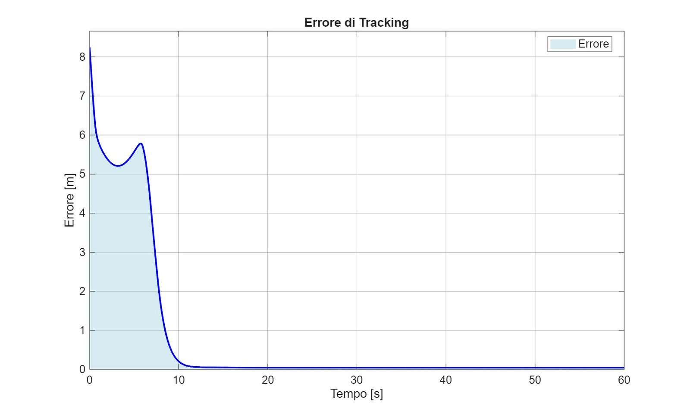 |
| **FL + LQR:** reaches ~0.5 cm, but the oscillations take about 400 s to decay. | **FL + LQR + PID:** reaches ~0.5 cm in about 11 s without oscillations, approaching in forward gear. |

---

## 4. Bicycle–trailer: nonlinear MPC

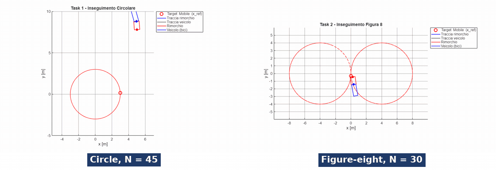

*Centralized NMPC inspired by Kayacan et al. (2015) (animation at 3× speed).*

**Formulation**
- Exact nonlinear kinematics propagated with RK4 (dt = 0.05 s); optimization with `fmincon` (SQP).
- Cost: J = Σ (eᵀQe + uᵀRu + Δuᵀ R_Δu Δu); prediction horizon N = 30 or 45, control horizon N_c = 8.
- Hard constraints: −1 ≤ v ≤ 3 m/s, |δ| ≤ 35°, **anti-jackknife** |φ| ≤ 60°.

**Results**

| Scenario | Steady-state error | Settling time | Computation time |
|---|---|---|---|
| Circle, N = 30 | 6 mm | 23 s | 82 s |
| Circle, N = 45 | 6 mm | 14 s | 118 s |
| Figure-eight, N = 30 | 2.5 cm | 4 s | 100 s |
| Figure-eight, tightened constraints (\|δ\| ≤ 20°, \|φ\| ≤ 45°) | peaks up to 62 cm | – | 65 s |

| | |
|---|---|
| 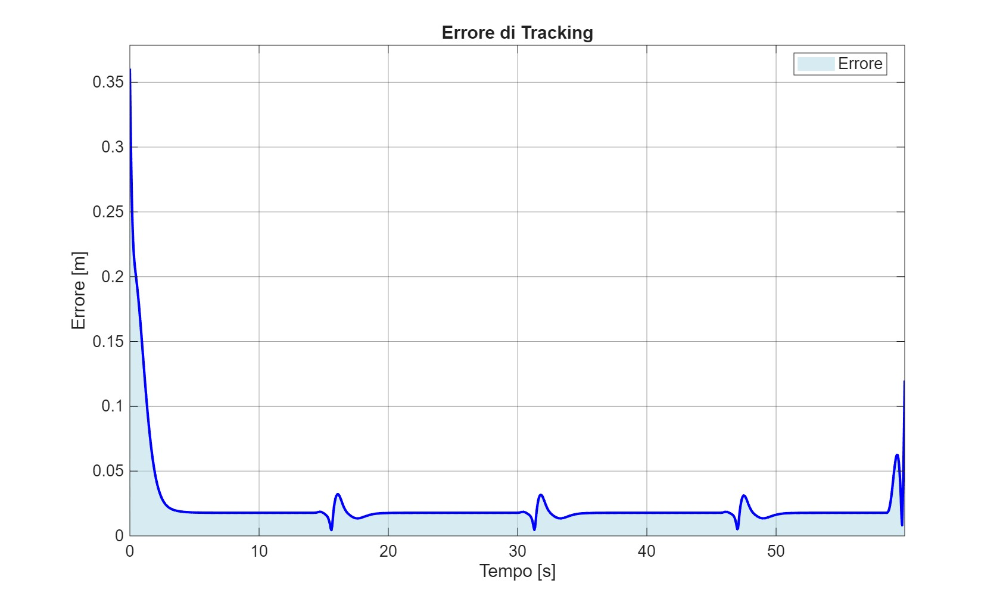 | 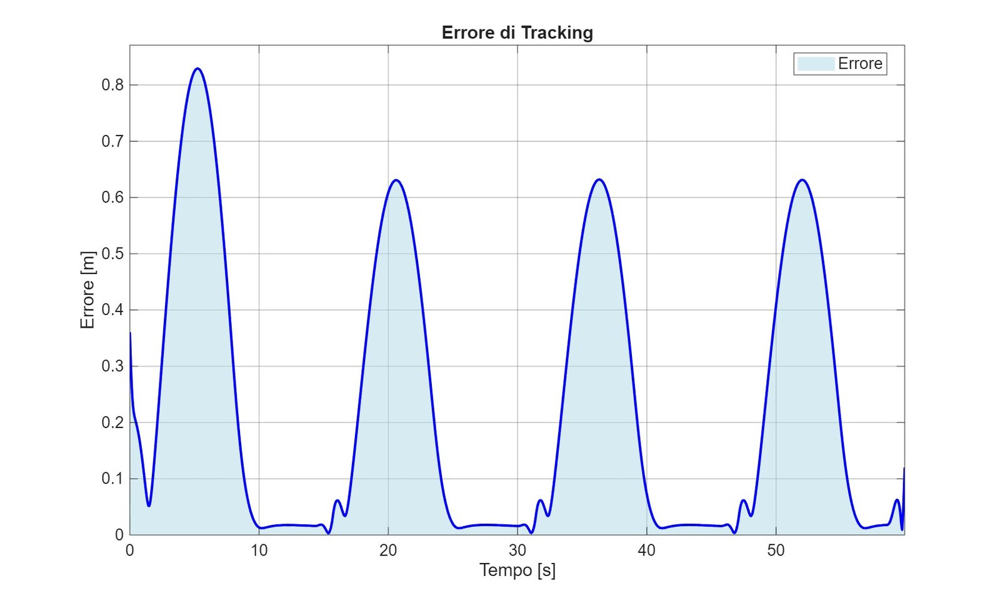 |
| **Figure-eight:** fast convergence and a small steady-state error. | **Tightened constraints:** the controller stays stable, but tracking degrades. |

A longer horizon improves maneuver planning and settling time at a higher computational cost.

<b>More figures</b>

| | |
|---|---|
| 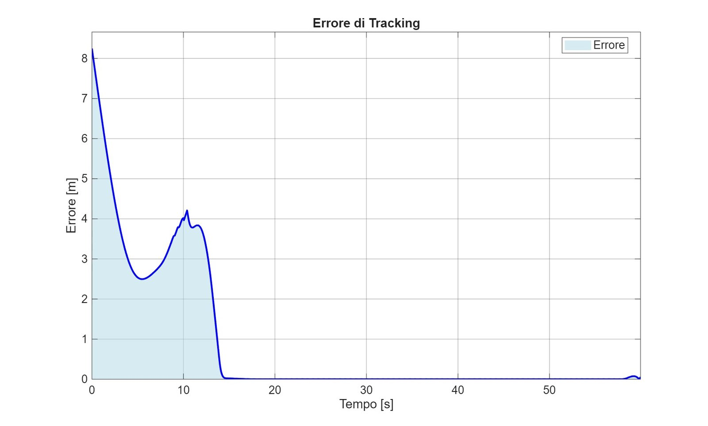 | 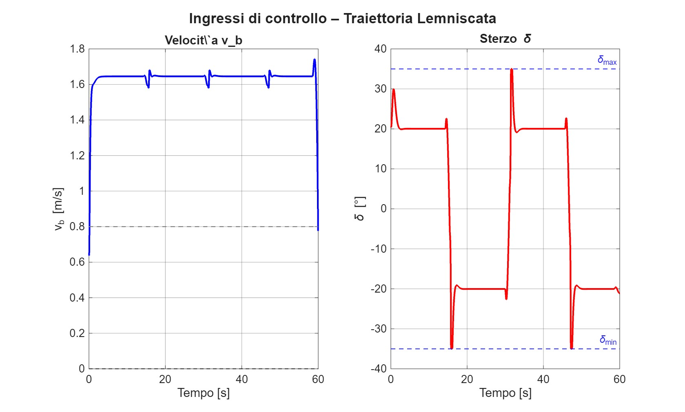 |
| Tracking error, circle, N = 45 | Control inputs on the figure-eight path, within the constraints |

---

## How to run

MATLAB R2024a or later with Simulink, Robotics System Toolbox, Control System Toolbox and Optimization Toolbox. In each folder, run `main.m` (`main_MPC.m` for part 4).

## Tech stack

`MATLAB` · `Simulink` · `Robotics System Toolbox` · `Computed torque` · `Adaptive control` · `Backstepping` · `Feedback linearization` · `LQR` · `Nonlinear MPC`
